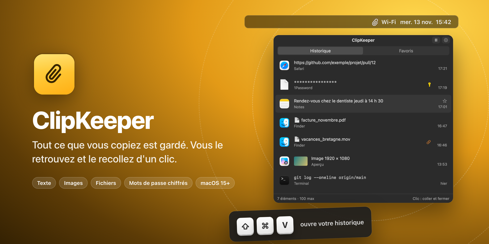
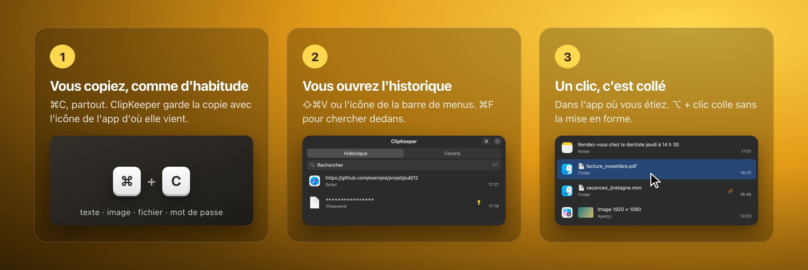
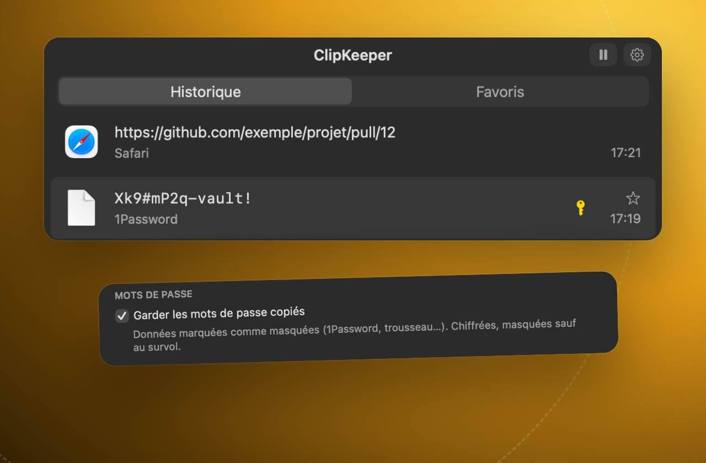
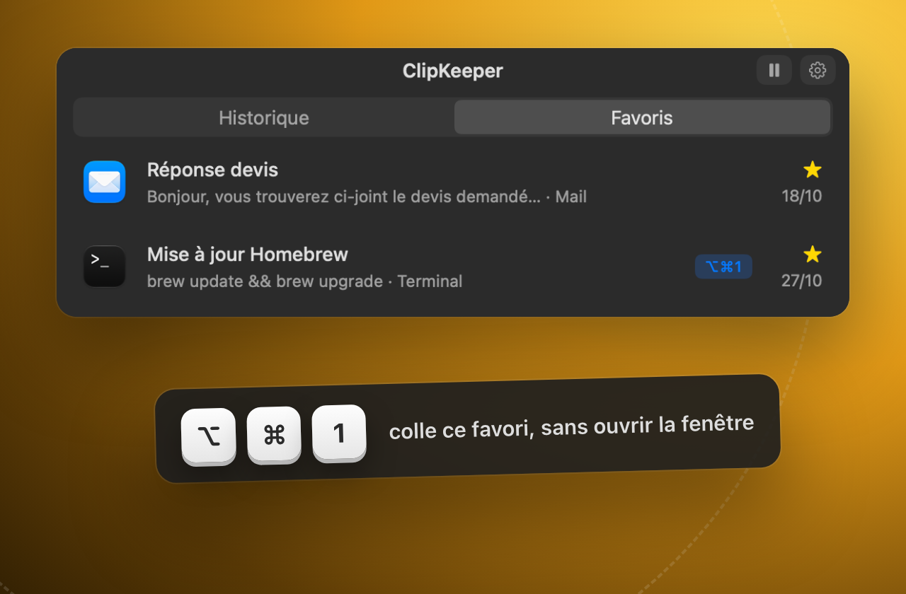
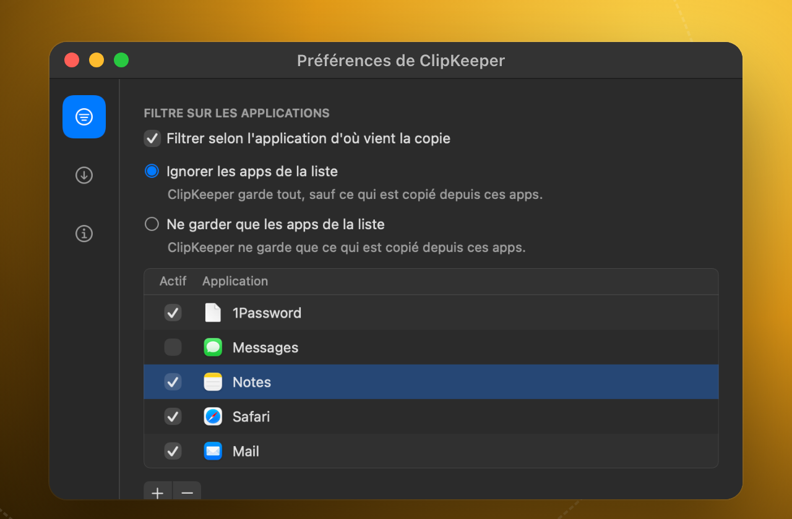
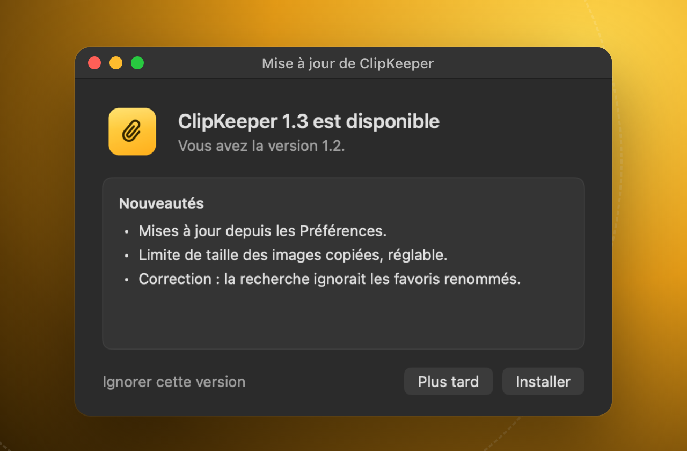

   
  macOS 15 ou plus récent · Mac à puce Apple

## Comment ça marche

ClipKeeper garde tout ce que vous copiez : texte, texte mis en forme, images, fichiers, et même les formats propres à une app. Recoller restitue la copie telle qu'elle était. Pas de compte, pas de serveur : l'historique reste sur votre Mac.

## Ce qu'il sait faire

<table>
<tr>
<td width="50%" valign="top"> <b>Vos mots de passe, chiffrés</b> Copiés depuis 1Password, Mots de passe ou le Trousseau, ils sont gardés chiffrés et masqués. Vous les voyez en passant la souris dessus, pas avant.</td>
<td width="50%" valign="top"> <b>Des favoris à portée de touche</b> Gardez à part ce que vous recollez souvent. Donnez-leur un nom, rangez-les dans votre ordre, et attribuez à chacun un raccourci qui le colle sans ouvrir la fenêtre.</td>
</tr>
<tr>
<td width="50%" valign="top"> <b>Vous choisissez ce qui est gardé</b> Ignorez les copies de certaines apps, ou ne gardez que celles-là. Choisissez combien d'éléments garder et pendant combien de jours. Et suspendez l'enregistrement d'un clic.</td>
<td width="50%" valign="top"> <b>Des mises à jour contrôlées</b> ClipKeeper vous prévient quand une version sort et l'installe à votre demande, après avoir vérifié sa signature. Une app qui n'est pas la bonne est refusée.</td>
</tr>
</table>

Et aussi : recherche dans tout l'historique (⌘F), collage en texte brut (⌥ + clic), aperçu d'un élément en entier (barre d'espace), ⌘1 à ⌘9 pour les premiers éléments, navigation au clavier, thème clair ou sombre, icône dans la barre de menus et/ou le Dock.

## Installer

1. Téléchargez `ClipKeeper-<version>.dmg` dans la [dernière version](https://github.com/NoktuaLabs/ClipKeeper-releases/releases/latest).
2. Ouvrez-le et glissez **ClipKeeper** dans le dossier **Applications**.
3. Premier lancement : macOS refuse d'ouvrir l'app. Allez dans **Réglages Système → Confidentialité et sécurité**, puis cliquez sur **Ouvrir quand même** (voir la question plus bas).
4. ClipKeeper vous guide ensuite : une autorisation (Accessibilité) et cinq réglages essentiels. Ensuite, ⇧⌘V ouvre votre historique.

## Questions fréquentes

<b>Mes copies quittent-elles mon Mac ?</b>

Non. L'historique est rangé dans votre dossier utilisateur (`Bibliothèque/Application Support/ClipKeeper`), et nulle part ailleurs. ClipKeeper n'a ni compte ni serveur.

Sa seule connexion à Internet sert aux mises à jour : il lit la liste des versions publiées sur ce dépôt GitHub, et télécharge la nouvelle version quand vous l'acceptez.

Les mots de passe sont chiffrés (voir plus bas). Le reste de l'historique n'a pas de chiffrement propre à ClipKeeper : il est protégé comme vos autres fichiers, par votre session et par FileVault si vous l'avez activé.

<b>Pourquoi macOS refuse-t-il d'ouvrir l'app la première fois ?</b>

ClipKeeper n'est pas distribué par l'App Store, et sa signature n'est pas certifiée par Apple. Au premier lancement, macOS l'arrête donc par précaution.

Pour l'ouvrir : **Réglages Système → Confidentialité et sécurité**, descendez jusqu'au message sur ClipKeeper, puis cliquez sur **Ouvrir quand même** et confirmez. Vous ne le faites qu'une fois : les mises à jour suivantes passent par ClipKeeper lui-même.

<b>Comment se font les mises à jour ?</b>

ClipKeeper vérifie s'il existe une nouvelle version : chaque jour par défaut, ou au lancement, chaque semaine, ou seulement quand vous cliquez sur **Vérifier maintenant** (Préférences → Mises à jour).

Quand une version sort, il vous montre ses nouveautés. Vous choisissez : **Installer**, **Plus tard** ou **Ignorer cette version**. Une option permet aussi de les installer automatiquement.

Avant d'installer, ClipKeeper contrôle la nouvelle app : elle doit porter la même signature que celle que vous avez, et le numéro de version annoncé. Sinon, elle est refusée et rien ne change. Ensuite, ClipKeeper se ferme, se remplace et se relance. Vos réglages et vos autorisations restent.

Si vous avez une version antérieure à 1.3, installez la nouvelle à la main une dernière fois : glissez-la dans Applications en remplaçant l'ancienne.

<b>Comment mes mots de passe sont-ils protégés ?</b>

ClipKeeper reconnaît un mot de passe à la marque que posent 1Password et la plupart des gestionnaires, ou à l'app d'où il vient (Mots de passe, Trousseau d'accès).

- Il est chiffré (AES-256) avant d'être rangé. La clé est dans le trousseau de votre Mac, pas avec l'historique.
- Dans la liste, il est masqué : seize points, sans révéler sa longueur. Il s'affiche en clair quand vous passez la souris dessus.
- Il n'apparaît jamais dans l'aperçu, et la recherche ne lit pas son contenu.
- Si macOS doit redemander l'accès au trousseau, ClipKeeper vous le dit d'abord sur un écran à lui : pas de fenêtre système par surprise.

Vous préférez ne pas les garder ? Décochez **Garder les mots de passe copiés** (Préférences → Filtres). Les mots de passe déjà gardés et leur clé sont alors effacés, après confirmation.

<b>Pourquoi l'autorisation Accessibilité ?</b>

Pour coller à votre place. Quand vous cliquez sur un élément, ClipKeeper le remet dans le presse-papiers, puis tape ⌘V dans l'app où vous étiez. macOS réserve ce geste aux apps autorisées dans **Réglages Système → Confidentialité et sécurité → Accessibilité**.

Sans elle, ClipKeeper marche quand même : un clic remet l'élément dans le presse-papiers, et vous faites ⌘V vous-même. Vous pouvez aussi régler le clic sur « copie seulement ».

<b>⇧⌘V sert déjà dans une de mes apps. Puis-je changer le raccourci ?</b>

Oui, dans **Préférences → Raccourcis** : cliquez sur le raccourci, puis tapez la nouvelle combinaison. Par défaut, ⇧⌘V remplace le « coller sans mise en forme » de Chrome, Slack ou Google Docs. ClipKeeper a d'ailleurs le sien : ⌥ + clic sur un élément.

 

Une app <b><a href="https://github.com/NoktuaLabs">NoktuaLabs</a></b> · apps · humain × IA

